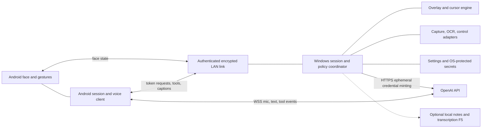

# Architecture and boundaries

Overall port design; Android F1 is implemented, remaining platform boundaries
remain [proposals](TRD.md).
Source owners are in [PORTING-MAP](PORTING-MAP.md).

F1 implements only the Android animator/renderer plus an offline demo in
`android/`. D007 selects Kotlin/Compose Canvas. All session/voice/network/Windows
components except the F2 overlay remain planned; neither offline demo has such connections.

There is no required hosted backend or cloud database. OpenAI is an external
service boundary, not this project's persistence layer. A future relay/backend
requires a separate decision, threat model, budget and scope authorization.

## Components

| Component | Responsibility | Boundary |
| --- | --- | --- |
| Android animator/renderer | Vector paths, mood targets, spring step, gestures, lifecycle | Frame input is data; no API/tool side effects in drawing |
| Android session store | Local transcript entries, crash recovery, export/delete | Versioned private storage; no implied cloud sync |
| Android voice client | Mic conversion, hold-to-ask, chirps, reconnect | Ephemeral credentials only; cloud opt-in; API calls deferred to F4 |
| Device-link codec | UTF-8 LF framing, correlation, validation, flow control | Pure codec separate from TLS and discovery |
| Pairing/trust | Enroll, authenticate, revoke, reconnect | Bind device identity to verified key, not a service name |
| Windows coordinator | Route face, token requests, tools and captions | Authenticate and authorize before privileged dispatch |
| Windows overlay | Pure cursor engine plus platform window/compositor | Click-through; no input injection in passive mode |
| Windows context adapters | Capture, OCR and accessible target extraction | Permission, freshness, coordinate and redaction checks |
| Windows action executor | Optional F5 input/app actions | Disabled by default, explicit grants, confirmation and immediate stop |
| Windows storage | Settings, trust metadata and protected key material | Separate nonsecret config from protected secrets and private notes |

## Data ownership and concurrency

Android owns each session UUID and ordered entries. Windows owns its display
snapshot and transient target IDs; a stale ID must not resolve against a different
snapshot. Windows settings choose home position/trail/size; protocol state carries
only what the peer needs. Shared contracts are language-neutral documentation and
fixtures until separately authorized implementation establishes generated types.

Use immutable events between render, network/audio and privileged work. One
serialized action executor must recheck grants and cancellation at execution,
including after animation delays. Face updates may coalesce; token/tool replies
must retain request identity. Disconnect cancels pending privilege work and expires
ephemeral authorization. Reconnect restores trust, not old action approval.

## Source-observed differences

[PhoneServer](../Mac/Sources/GooglyMac/PhoneServer.swift) broadcasts to multiple
phones and admits connections without authentication. [MacLink](../iOS/Sources/MacLink.swift)
auto-selects a remembered service name or first result. [Keychain](../Mac/Sources/GooglyMac/Keychain.swift)
is a permission-restricted JSON file despite its name. These are not target
security guarantees. New TLS/pairing and protected Windows storage deliberately
change the trust boundary while retaining face/event semantics.

## F2 implemented overlay boundary

`windows/Bluey.Core` contains renderer-independent motion, geometry, effects and
FaceState output. `windows/Bluey.Windows` is a WPF/Win32 primary-monitor overlay
with separately accessible controls and local nonsecret settings; D008 selects
.NET 10/Windows 11 x64. No coordinator, capture/OCR/actions, audio or sockets
are implemented. Physical desktop behavior remains unverified even after CI.
