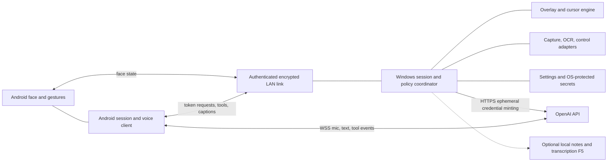

# Architecture and boundaries

Overall port design; Android F1 is implemented, remaining platform boundaries
remain [proposals](TRD.md).
Source owners are in [PORTING-MAP](PORTING-MAP.md).

F1 supplies the Android animator/renderer in `android/` (D007); F2 supplies the
Windows overlay (D008). F3 adds the authenticated local face link (D009). Voice,
capture/OCR, action and cloud components below remain future boundaries.

There is no required hosted backend or cloud database. OpenAI is an external
service boundary, not this project's persistence layer. A future relay/backend
requires a separate decision, threat model, budget and scope authorization.

## Components

| Component | Responsibility | Boundary |
| --- | --- | --- |
| Android animator/renderer | Vector paths, mood targets, spring step, gestures, lifecycle | Frame input is data; no API/tool side effects in drawing |
| Android session store | Local transcript entries, crash recovery, export/delete | Versioned private storage; no implied cloud sync |
| Android voice client | Mic conversion, hold-to-ask, chirps, reconnect | Ephemeral credentials only; cloud opt-in; API calls deferred to F4 |
| Device-link codec | UTF-8 LF framing, correlation, validation, flow control | Pure codec separate from TLS and discovery |
| Pairing/trust | Enroll, authenticate, revoke, reconnect | Bind device identity to verified key, not a service name |
| Windows coordinator | Route face, token requests, tools and captions | Authenticate and authorize before privileged dispatch |
| Windows overlay | Pure cursor engine plus platform window/compositor | Click-through; no input injection in passive mode |
| Windows context adapters | Capture, OCR and accessible target extraction | Permission, freshness, coordinate and redaction checks |
| Windows action executor | Optional F5 input/app actions | Disabled by default, explicit grants, confirmation and immediate stop |
| Windows storage | Settings, trust metadata and protected key material | Separate nonsecret config from protected secrets and private notes |

## Data ownership and concurrency

Android owns each session UUID and ordered entries. Windows owns its display
snapshot and transient target IDs; a stale ID must not resolve against a different
snapshot. Windows settings choose home position/trail/size; protocol state carries
only what the peer needs. Shared contracts are language-neutral documentation and
fixtures until separately authorized implementation establishes generated types.

Use immutable events between render, network/audio and privileged work. One
serialized action executor must recheck grants and cancellation at execution,
including after animation delays. Face updates may coalesce; token/tool replies
must retain request identity. Disconnect cancels pending privilege work and expires
ephemeral authorization. Reconnect restores trust, not old action approval.

## Source-observed differences

[PhoneServer](../Mac/Sources/GooglyMac/PhoneServer.swift) broadcasts to multiple
phones and admits connections without authentication. [MacLink](../iOS/Sources/MacLink.swift)
auto-selects a remembered service name or first result. [Keychain](../Mac/Sources/GooglyMac/Keychain.swift)
is a permission-restricted JSON file despite its name. These are not target
security guarantees. New TLS/pairing and protected Windows storage deliberately
change the trust boundary while retaining face/event semantics.

## F2 implemented overlay boundary

`windows/Bluey.Core` contains renderer-independent motion, geometry, effects and
FaceState output. `windows/Bluey.Windows` is a WPF/Win32 primary-monitor overlay
with separately accessible controls and local nonsecret settings; D008 selects
.NET 10/Windows 11 x64. F2 itself contains no network logic. F3 networking stays outside the pure engine;
physical desktop/performance measurements remain separate from CI.

## F3 implemented link boundary

`windows/Bluey.Link` owns strict framing/codec, invitation state, TLS host, bounded
connection/session loops and significant-face filtering. It has no dependency on
WPF or Bluey.Core. `Bluey.Windows/Connection` adapts DNS-SD, CurrentUser DPAPI,
QR enrollment and explicit controls. Renderer frames publish one immutable face
sample; crypto/storage/socket work runs on background tasks.

Android `link/` separates strict pure wire/bootstrap/face delivery from NSD,
Android Keystore, TLS socket lifecycle and connection UI. It retains one latest
validated face and translates fresh receipt time once into the animator's active
clock. Existing animation/geometry/render files are unchanged. Both codecs execute
the same corpus in `protocol/`; the exact wire/security state machine is documented
there. Four host slots, bounded frames/rates/deadlines, conflated face data and
foreground-only client cleanup prevent unbounded animation queues. This F3 link
has no generalized privileged dispatcher or F4/F5 endpoint.

## F4-A offline presentation

Pure Kotlin `voice/VoiceController`, indicator math and face selection own state,
clock and mock events. Compose/Canvas adapt gestures/public screen geometry only.
DeviceLink sends bounded presentation events on its existing authenticated IO path;
C# Bluey.Link validates schema and per-session caption state. Bluey.Windows adapts
snapshots to the existing bubble/engine controls. No socket or certificate work runs
on rendering frames. Planned consent is immutable OFF; no provider/media layer.

## F4-B native live path

Bluey.Link LiveAuthority owns lease-bound cloud authorization, rate/session/TTL
limits and asynchronous issuance; OpenAiIssuer uses fixed HTTPS with no redirects.
Bluey.Windows AI owns CurrentUser DPAPI credentials and explicit configuration UI.
Android LiveCoordinator adapts the existing VoiceController to RealtimeEngine,
AudioRecord/streaming resampler/local AudioTrack chirps and one OkHttp WebSocket.
Pure event/PCM reducers and injected LAN/capture/socket interfaces support offline
integration tests; drawing never performs audio/socket/certificate work. Existing
F3 trust/discovery and F4-A presentation/face pipelines remain authoritative.
No backend, token HTTP server, capture/tool router, transcript store or second UI.
