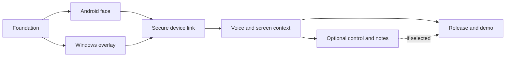

# Ordered implementation plan

F0 is complete; F1 implementation is merged with device QA open. F2 Windows
implementation is merged under D008; F3 is authorized/active under D009, F4–F6 planned.
F1 implementation/build checks and physical-device acceptance are separate.
Use [checkpoint states](../tracking/CHECKPOINTS.md) and [QA](QA.md); gate numbers
are not evidence of progress. Changes of scope require [a decision](../tracking/DECISIONS.md).

This graph expresses dependencies, not authorization for concurrent writers.

| Gate | Small ordered slices | Exit checks |
| --- | --- | --- |
| F0 | Verify baseline/provenance; inspect source; canonical docs; four local skills; validate | Navigation/links, source map, agent rules, tracking, frontmatter/JSON and whitespace pass; source unchanged |
| F1 | Decide Android SDK/device matrix; approve minimal setup; translate pure FaceAnimator; paths/palette/fonts; gestures/lifecycle | Deterministic clock/RNG tests; fixed-frame comparisons; physical Android recordings of all moods/transitions; deny/background behavior |
| F2 | Decide .NET/UI/renderer/OS matrix; approve minimal setup; pure flight/curve engine; transparent window; trails/bubbles/settings/hotkeys | Unit math/redirect checks; click-through/focus, DPI/capture interaction; real Windows recordings and pacing evidence |
| F3 | Decide threat-reviewed pairing/version/service profile; codecs; trust stores; discovery/TLS; reconnect/correlation | Cross-language fixtures, bounds/fuzz/errors, rogue/revoked/replayed peer tests, no downgrade; real Windows + Android sync |
| F4 | Recheck current official API/cost/access; explicit mic/cloud/capture controls; protected key and token minting; Android PCM/chirps/session; Windows OCR/pointing | Mock/offline/permission tests; separately authorized live session; screen/coordinate/caption comparison; sleep/revoke/network loss verified |
| F5 optional | Choose control and/or notes as separate slices; action policy/stop first; then adapters; recording retention/media protocol before transcription | Consequential approval enforced in app; stop mid-drag/queue; hostile content refusal; safe notes paths, retry/idempotency/delete/export and speaker semantics |
| F6 | Freeze selected scope; reproducible builds/signing plan; exact artifact hashes; clean-machine/device QA; truthful demo/portfolio docs | CI/build evidence, verified hashes and install/permissions, license notices, known limits; publication/release only with separate authorization |

Before F1: choose the smallest pure-animator slice and confirm proposed Android
toolchain/device matrix. Do not start networking or paid API integration as part
of a face spike. F2 can be designed independently, but sharing a branch does not
authorize simultaneous overlapping changes. F3 must close trust/transport decisions
before sensitive F4 data crosses the LAN. F5 is optional and can be omitted from
a V1 F6 release with limitations stated.

## Handoff granularity

Each slice should specify allowed paths, source symbols, expected behavior, cheap
tests and required device evidence. Save exact commands, tool versions, tested
commit, input seed/timestamps, capture/artifact hashes and unresolved failures.
An exit condition needing unavailable hardware stays planned/active/blocked,
never verified by a substitute source review. No CI workflow or build scaffolding
is created by this foundation task.

F1 follow-up authorization now covers `android/`, the Android CI workflow and
relevant canonical docs/tracking. D007 selects the Android tool versions and
renderer. This does not authorize Windows/network/API work. F1 cannot become
fully verified until physical-device comparison and pacing checks have evidence.

F2 scope now authorizes `windows/`, `.github/workflows/windows.yml` and relevant
canonical guidance/tracking. Pure C# and WPF/Win32 implementation is separate
from physical click-through, focus, DPI/capture interaction, fidelity and pacing
acceptance. No F3/F4/F5 capabilities are included. See [Windows workflow](../windows/README.md).

F3 authorization now covers the strict shared contract/fixtures, native secure
Windows host and Android client, protected identities, discovery, explicit pairing
and revocation, passive face synchronization, both CI artifacts, and canonical
evidence. F1/F2 graphics/math stay intact. The developer reports F2 functional
smoke acceptance; measured performance QA remains open. Physical F3 pairing,
reconnect and latency need the produced EXE/APK on the actual laptop/phone.

## F4-A implementation boundary

Offline six-state controller, source ModeIndicator math, native border/gestures,
face override precedence, strict authenticated presentation events, Windows captions
and planned OFF consents are this checkpoint. F4-B live provider/audio/token issuance,
key configuration and all capture/privileged tools remain unimplemented. Acceptance
requires matching app CI plus separately recorded physical gesture/fidelity QA.

## F4-B live slice

Protected desktop key UI, narrow authenticated live consent/grant/request/token/stop,
foreground Android capture/resampling/WSS, GA text events and local chirps are included.
Offline F4-A remains available. Fake integration/real loopback TLS/DPAPI checks precede
physical or paid acceptance. No cloud session is executed in development/CI. Screen
capture/OCR/pointing, tools, notes, hosted relay and background services remain excluded.

### F4-B Gemini amendment / D012

Provider-neutral implementation uses AudioProtocol/AudioTurn and a partial
AudioAuthority on the existing LiveAuthority; no second authorization/trust system.
Android AudioUpload and the existing LiveCoordinator reuse native capture, gestures,
caption events and chirps. Existing32-slot F3 outbox streams bounded numbered chunks;
Windows assembles one authorized turn and zeroes it on completion/cancel/timeout.
Windows UI supports provider selection plus separate protected Gemini/OpenAI key
operations, Free Tier and cloud review; Gemini live authorization is explicitly
blocked, and OpenAI production invocation is disabled. Existing offline simulation
and original F1/F2/F3/F4-A code paths stay available.

**Incomplete prerequisite:** official Gemini audio/pricing/billing/rate-limit docs
are policy403; gemini-3.8-flash and free-tier audio support cannot be verified.
Do not implement a guessed HTTP contract or substitute a model. The production
IAudioAnswers adapter, fake HTTP contract tests and quota/safety-schema handling
remain unimplemented until verification. Tests of synthetic adapters establish
transport/cancellation behavior only. This is not a completed live Gemini integration.
