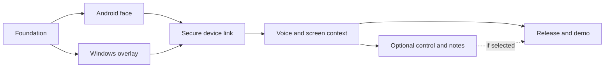

# Ordered implementation plan

All implementation gates are **planned**. F0 adds documentation/skills only.
Use [checkpoint states](../tracking/CHECKPOINTS.md) and [QA](QA.md); gate numbers
are not evidence of progress. Changes of scope require [a decision](../tracking/DECISIONS.md).

This graph expresses dependencies, not authorization for concurrent writers.

| Gate | Small ordered slices | Exit checks |
| --- | --- | --- |
| F0 | Verify baseline/provenance; inspect source; canonical docs; four local skills; validate | Navigation/links, source map, agent rules, tracking, frontmatter/JSON and whitespace pass; source unchanged |
| F1 | Decide Android SDK/device matrix; approve minimal setup; translate pure FaceAnimator; paths/palette/fonts; gestures/lifecycle | Deterministic clock/RNG tests; fixed-frame comparisons; physical Android recordings of all moods/transitions; deny/background behavior |
| F2 | Decide .NET/UI/renderer/OS matrix; approve minimal setup; pure flight/curve engine; transparent window; trails/bubbles/settings/hotkeys | Unit math/redirect checks; click-through/focus, DPI/capture interaction; real Windows recordings and pacing evidence |
| F3 | Decide threat-reviewed pairing/version/service profile; codecs; trust stores; discovery/TLS; reconnect/correlation | Cross-language fixtures, bounds/fuzz/errors, rogue/revoked/replayed peer tests, no downgrade; real Windows + Android sync |
| F4 | Recheck current official API/cost/access; explicit mic/cloud/capture controls; protected key and token minting; Android PCM/chirps/session; Windows OCR/pointing | Mock/offline/permission tests; separately authorized live session; screen/coordinate/caption comparison; sleep/revoke/network loss verified |
| F5 optional | Choose control and/or notes as separate slices; action policy/stop first; then adapters; recording retention/media protocol before transcription | Consequential approval enforced in app; stop mid-drag/queue; hostile content refusal; safe notes paths, retry/idempotency/delete/export and speaker semantics |
| F6 | Freeze selected scope; reproducible builds/signing plan; exact artifact hashes; clean-machine/device QA; truthful demo/portfolio docs | CI/build evidence, verified hashes and install/permissions, license notices, known limits; publication/release only with separate authorization |

Before F1: choose the smallest pure-animator slice and confirm proposed Android
toolchain/device matrix. Do not start networking or paid API integration as part
of a face spike. F2 can be designed independently, but sharing a branch does not
authorize simultaneous overlapping changes. F3 must close trust/transport decisions
before sensitive F4 data crosses the LAN. F5 is optional and can be omitted from
a V1 F6 release with limitations stated.

## Handoff granularity

Each slice should specify allowed paths, source symbols, expected behavior, cheap
tests and required device evidence. Save exact commands, tool versions, tested
commit, input seed/timestamps, capture/artifact hashes and unresolved failures.
An exit condition needing unavailable hardware stays planned/active/blocked,
never verified by a substitute source review. No CI workflow or build scaffolding
is created by this foundation task.
